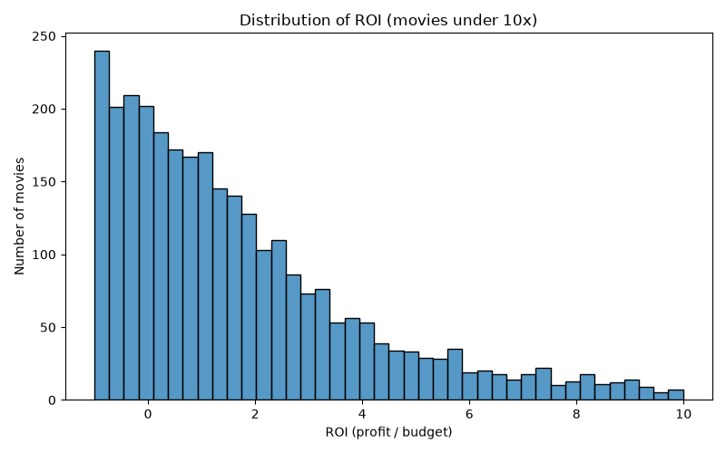
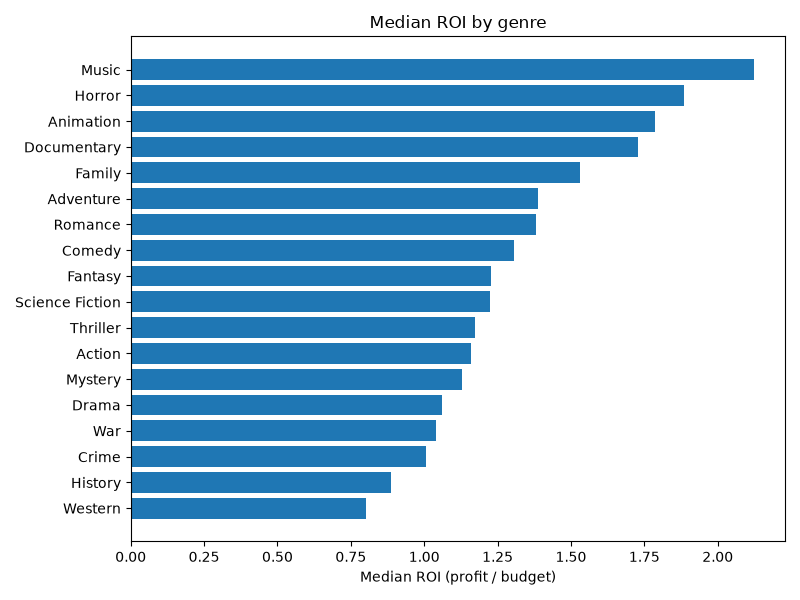
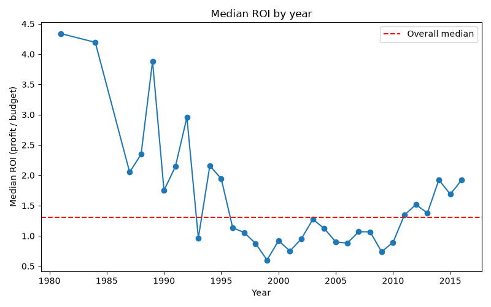
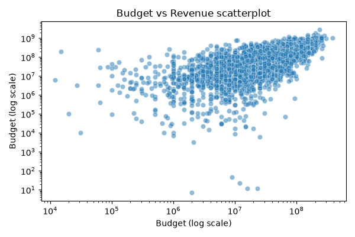
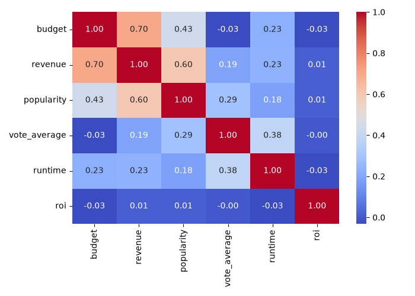

# What Makes a Movie a Hit? An ROI Analysis of 3,200 Films

I analyzed the TMDB 5000 movie dataset to answer one question: **which kinds of movies give the best return on their budget?**

I defined ROI as `(revenue - budget) / budget`. An ROI of 1 means a movie earned back its budget once more as profit, and an ROI of -1 means it earned almost nothing.

## Tools

Python, pandas, NumPy, Matplotlib, Seaborn

## Data

The TMDB 5000 Movie Dataset from Kaggle (`tmdb_5000_movies.csv`). The file is not included in this repo.
To run the project, download it from Kaggle, create a folder called `archive`, and place the CSV inside it.

## Cleaning

- The raw file has **4,803 movies**. Of these, 1,037 have a budget of 0 and 1,427 have a revenue of 0. Those zeros mean "not recorded", not "free".
- Even after removing zeros, some budgets were absurdly small (a budget of 1 produced an ROI in the millions). I kept only movies with **budget above 10,000 and revenue above 0**, leaving **3,213 movies**.
- Genres are stored as text that looks like a list, so I parsed them with `json.loads`. I then used `explode` so each movie counts once for every genre it belongs to.

## Key findings

### ROI is heavily skewed, so I use the median



The mean ROI is 9.88, but the median is only 1.30, because a few enormous hits drag the average up. The most common single outcome is a near-total loss: the tallest bar sits at an ROI of about -1 to -0.7 (around 240 movies). The bars then shrink steadily to the right, so big winners are rare. The chart hides the 237 movies with an ROI of 10 or more, such as Paranormal Activity (ROI of about 12,900 on a 15,000 budget).

### Genre



Music (2.12) and Horror (1.89) have the highest median ROI, followed by Animation (1.79). Western (0.80) and History (0.89) are the lowest. Horror's result is the most trustworthy of the top genres, because it rests on 328 movies. Genres with fewer than 30 movies were excluded, and Documentary (37 movies, median 1.73) sits close to that cutoff, so treat its rank with caution.

### Year



Median ROI was above the overall median (1.30, the dashed line) for most years from 1987 to 1995 and again from 2011 to 2016. It sat below the line for almost every year from 1996 to 2010, with the lowest values in 1999 (0.60) and 2009 (0.74). Only years with at least 20 movies are plotted, and the 1980s years each have only 21 to 27 movies, so those peaks are noisier than the recent years.

### Budget vs revenue



Movies with bigger budgets tend to earn more revenue (correlation of 0.70), but a big budget does not guarantee a big return. Both axes use a log scale, where each gridline is 10 times the previous one. This squeezes huge differences into small distances, so the relationship looks tighter than it would on a normal scale.

### Correlations



Budget has the strongest link with revenue (0.70), followed by popularity (0.60). ROI is nearly uncorrelated with everything, including budget (-0.03), so spending more does not predict a better return. Correlation is not causation, and a few extreme ROI outliers can distort these numbers.

## Limitations

- Only movies with both budget and revenue recorded are included. The dataset also appears to hold only a selected slice of older films (about 24 per year in the 1980s versus 150+ per year in the 2010s), so early-year results may reflect which movies are in the data.
- ROI ignores marketing and distribution costs, so real returns are lower than shown.
- Medians from groups with few movies are noisy, which is why small genres and years were filtered out.
- The cutoff of 10,000 for budget is a judgment call, and a different threshold would change the top-ROI rankings.

## How to run

```bash
python -m venv .venv
.venv\Scripts\activate        # Mac/Linux: source .venv/bin/activate
pip install -r requirements.txt
python analysis.py
```

The five charts are saved in the `charts` folder.

## Project structure

- `analysis.py`: the full analysis (load, clean, aggregate, chart)
- `charts/`: output images
- `exploration/`: my practice scripts while learning
- `requirements.txt`: Python libraries used